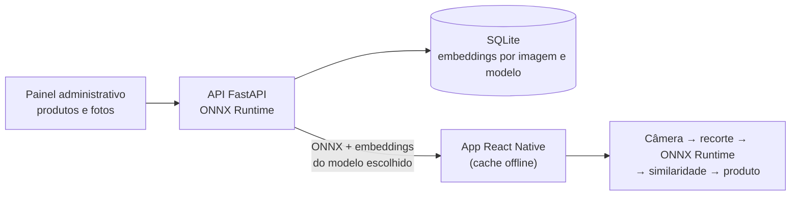

# VisualMatch: Reconhecimento Visual de Colchões em Dispositivos Móveis com Embeddings de Redes Neurais Pré-treinadas

#### Alunos: [Rafael Zurli Bittencourt Bravo](https://github.com/rbravo) e [Raissa Zurli Bittencourt Bravo](https://github.com/RaissaBravo)
#### Orientadora: [Manoela Rabello Kohler](https://github.com/manoelakohler)

---

Trabalho apresentado ao curso [BI MASTER](https://ica.puc-rio.ai/bi-master) como pré-requisito para conclusão de curso e obtenção de crédito na disciplina "Projetos de Sistemas Inteligentes de Apoio à Decisão".

- [Link para o código](https://github.com/RaissaBravo/AIVisualMatch).

- [Instruções de instalação e execução](RUN.md).

---

### Resumo

Em lojas e showrooms de colchões, o vendedor precisa identificar rapidamente qual modelo o cliente está vendo para informar preço e características. Como os modelos de uma mesma linha se diferenciam por detalhes de tecido, cor e acabamento, essa identificação costuma depender de consulta manual ao catálogo. Este trabalho apresenta o VisualMatch, um sistema de reconhecimento visual de produtos desenvolvido para o aplicativo de vendas de um fabricante de colchões: o vendedor aponta a câmera do celular para o colchão e o aplicativo identifica o modelo, o que facilita o acesso ao preço e às informações do produto.

O sistema é composto por uma API em FastAPI, com painel administrativo para o cadastro de produtos e fotos de referência, e por um aplicativo em React Native/Expo. A API extrai vetores de características (*embeddings*) das fotos com redes neurais pré-treinadas exportadas para ONNX, sem nenhum treinamento adicional. O aplicativo executa o mesmo modelo no próprio aparelho com ONNX Runtime e compara o quadro da câmera com as referências por similaridade de cosseno após a subtração do centroide, com média temporal e uma regra de decisão por limiar e margem. Depois da sincronização, o reconhecimento funciona sem conexão e as imagens da câmera não saem do aparelho.

Foram comparados quatro codificadores: MobileNetV2, MobileNetV3-Large, DINOv2-Small e MobileCLIP2-S0. A API mantém os quatro prontos ao mesmo tempo, e o aplicativo alterna entre eles em tempo de execução. Numa avaliação *leave-one-out* sobre o catálogo (190 imagens de 24 produtos), o MobileCLIP2-S0 obteve a maior acurácia top-1 (50,0%), enquanto o MobileNetV3-Large e o DINOv2-Small reduziram os reconhecimentos errados em relação ao MobileNetV2 (de 25,3% para 20,5% e 19,5%). Nos testes práticos com a câmera, o MobileNetV3-Large apresentou os melhores resultados na identificação dos colchões. Somados o tamanho reduzido (11,9 MB) e a licença permissiva — os pesos do MobileCLIP2 só podem ser usados em pesquisa —, ele foi o modelo escolhido para o produto.

### Abstract

In mattress stores and showrooms, salespeople need to quickly identify which model a customer is looking at in order to provide its price and features. Since models within the same line differ only in fabric, color and finishing details, this identification usually relies on manually searching the catalog. This work presents VisualMatch, a visual product recognition system developed for the sales app of a mattress manufacturer: the salesperson points the phone camera at a mattress and the app identifies the model, making the product's price and information easier to access.

The system consists of a FastAPI service, with an admin panel to register products and reference photos, and a React Native/Expo app. The API extracts feature vectors (embeddings) from the photos with pre-trained neural networks exported to ONNX, without any additional training. The app runs the same model on the device with ONNX Runtime and compares the camera frame with the references using cosine similarity after centroid subtraction, temporal averaging and a decision rule based on a threshold and a margin. After synchronization, recognition works offline and camera images never leave the device.

Four encoders were compared: MobileNetV2, MobileNetV3-Large, DINOv2-Small and MobileCLIP2-S0. The API keeps all four ready at the same time, and the app switches between them at runtime. In a leave-one-out evaluation on the catalog (190 images of 24 products), MobileCLIP2-S0 achieved the highest top-1 accuracy (50.0%), while MobileNetV3-Large and DINOv2-Small reduced wrong recognitions compared to MobileNetV2 (from 25.3% to 20.5% and 19.5%). In practical tests with the camera, MobileNetV3-Large delivered the best results in identifying the mattresses. Together with its small size (11.9 MB) and permissive license — MobileCLIP2 weights are restricted to research use — this made it the model chosen for the product.

### 1. Introdução

Fabricantes de colchões mantêm muitos modelos ativos ao mesmo tempo (o catálogo usado neste trabalho tem 23), muitos deles da mesma linha e visualmente muito parecidos: o que distingue um modelo do outro é o padrão do tecido do tampo, a cor da faixa lateral, a espessura ou o tipo de acabamento. No ponto de venda, o vendedor precisa reconhecer o modelo exposto para consultar preço, condições e especificações, e hoje faz isso de memória ou procurando no catálogo. O processo é lento e sujeito a erro, sobretudo para vendedores novos ou quando o mostruário muda.

O VisualMatch foi desenvolvido para resolver esse problema no aplicativo de vendas de um cliente que fabrica colchões: o vendedor aponta a câmera do celular para o produto e o aplicativo indica qual é o modelo, para que o vendedor chegue rapidamente às informações dele.

Algumas restrições guiaram a solução:

- **Catálogo dinâmico e com poucas fotos.** Produtos entram e saem do catálogo, e cada um tem em média oito fotos de referência. Treinar um classificador exigiria muitas imagens por classe e um novo treinamento a cada mudança. Por isso o problema foi tratado como busca por similaridade: uma rede pré-treinada transforma cada foto em um vetor, e cadastrar um produto novo é só enviar as fotos dele, sem treinamento.
- **Uso no ponto de venda.** A conexão em lojas é instável, e a resposta precisa vir em cerca de um segundo. A inferência e a comparação acontecem no próprio celular, e a rede só é usada para sincronizar o catálogo.
- **Privacidade.** As imagens capturadas pela câmera não são enviadas a nenhum servidor.
- **Operação por não especialistas.** O catálogo é mantido por um painel web, sem intervenção técnica.

Os objetivos do trabalho foram (i) construir o sistema completo, do cadastro ao reconhecimento no aparelho, e (ii) comparar codificadores pré-treinados de diferentes famílias para escolher o mais adequado ao domínio de colchões, considerando também tamanho do modelo e licença de uso.

### 2. Modelagem

#### 2.1 Arquitetura do sistema

- **API e painel administrativo** (Python, FastAPI, SQLite): cadastro de produtos e fotos, geração e armazenamento dos embeddings, backup e restauração do catálogo e distribuição dos modelos ONNX para o aplicativo.
- **Aplicativo** (React Native/Expo, Vision Camera, ONNX Runtime): sincroniza o catálogo, executa o modelo no aparelho e mostra os produtos mais parecidos com o que a câmera enxerga.

| Painel administrativo | Aplicativo |
| -------- | -------- |
|  |  |

#### 2.2 Extração de características

Foram usados quatro codificadores pré-treinados, sem ajuste fino, escolhidos para cobrir diferentes formas de pré-treino: classificação supervisionada no ImageNet (MobileNetV2 e MobileNetV3), aprendizado auto-supervisionado (DINOv2) e aprendizado contrastivo imagem-texto (MobileCLIP2).

| Modelo | Pré-treino | Entrada | Embedding | ONNX | Licença dos pesos |
| --- | --- | --- | --- | --- | --- |
| MobileNetV2 [1] | ImageNet, supervisionado (torchvision) | 224×224 | 1280 | 8,9 MB | BSD-3-Clause |
| MobileNetV3-Large [2] | ImageNet, supervisionado (torchvision) | 224×224 | 960 | 11,9 MB | BSD-3-Clause |
| DINOv2-Small [3] | LVD-142M, auto-supervisionado (ViT-S/14, token CLS) | 224×224 | 384 | 86,7 MB | Apache-2.0 |
| MobileCLIP2-S0 [4] | DFNDR-2B, contrastivo imagem-texto (com projeção CLIP) | 256×256 | 512 | 45,6 MB | Apple AMLR (somente pesquisa) |

Nos modelos MobileNet, o classificador foi removido e o embedding é a média global das ativações da última camada convolucional. Para o MobileNetV3-Large foram avaliadas duas saídas, e a de 960 dimensões (após o *pooling*) superou a de 1280 dimensões (camada anterior aos *logits*), como mostra a seção 3.2.

Todos os modelos foram exportados para ONNX com o mesmo contrato de entrada: pixels RGB `uint8` no formato `[1, S, S, 3]`. A conversão para ponto flutuante, a divisão por 255, a troca de layout e a normalização própria de cada modelo ficam dentro do grafo. Assim, a API e o aplicativo entregam exatamente o mesmo tensor a qualquer modelo, e só o tamanho da entrada muda. A exportação é reproduzível (gera arquivos idênticos byte a byte) e foi validada comparando a saída do ONNX com a do PyTorch (cosseno 1,000000). Todos os embeddings são normalizados pela norma L2.

#### 2.3 Reconhecimento no aparelho

1. A câmera captura uma foto por segundo (1280×960).
2. O aplicativo recorta a região central indicada na tela (75% × 45% do preview) e a redimensiona para a entrada do modelo.
3. O ONNX Runtime calcula o embedding no próprio aparelho, que é então normalizado.
4. O embedding é comparado com as referências do catálogo pela regra descrita a seguir.

#### 2.4 Regra de decisão

Fotos de colchões são muito parecidas entre si, e a similaridade de cosseno "bruta" entre produtos diferentes fica alta. Para destacar o que diferencia os produtos, o centroide de todas as referências do catálogo é subtraído de cada vetor (inclusive do vetor da câmera) antes do cálculo do cosseno. A pontuação de cada produto é a maior similaridade entre o quadro da câmera e as suas fotos de referência, e as pontuações são médias dos três últimos quadros, o que reduz oscilações.

O primeiro colocado só é aceito como reconhecimento quando atinge o limiar de similaridade (0,45) **e** supera o segundo colocado por uma margem mínima (0,08). A margem evita aceitar empates técnicos entre modelos parecidos, situação em que um limiar absoluto sozinho não basta. Os mesmos valores foram usados para todos os modelos, mas o aplicativo permite calibrá-los por modelo.

#### 2.5 Infraestrutura para comparar modelos

Para comparar os codificadores em condições reais, a API mantém os embeddings de todos os modelos ao mesmo tempo: cada foto cadastrada recebe um vetor de cada modelo, e na inicialização a API gera os que estiverem faltando. Cada embedding guarda a identificação (MD5) do arquivo do modelo que o gerou, e vetores produzidos por uma versão antiga do arquivo não são enviados ao aplicativo.

No aplicativo, um seletor na tela da câmera permite trocar o modelo em uso. Ao trocar, o aplicativo baixa da API o arquivo ONNX daquele modelo (verificado por MD5 e guardado em cache) e os embeddings correspondentes. Com isso, um mesmo produto pode ser apontado com cada um dos modelos em sequência, no mesmo local e com a mesma iluminação.

#### 2.6 Protocolo de avaliação

- **Avaliação offline (*leave-one-out*):** cada uma das 190 fotos do catálogo é usada como consulta contra as demais, com a mesma regra do aplicativo (subtração do centroide, melhor referência por produto, limiar 0,45 e margem 0,08). O catálogo tem 24 produtos: 23 modelos de colchão e um mouse usado nos testes iniciais. As métricas são:
  - **acurácia top-1:** produto correto em primeiro lugar;
  - **margem mediana** entre o primeiro e o segundo colocados;
  - **taxa de match certo:** consultas aceitas pela regra e corretas;
  - **taxa de match errado:** consultas aceitas pela regra, porém com o produto errado.
- **Testes práticos com a câmera:** os colchões foram apontados com o celular, alternando o modelo no seletor do aplicativo, e os resultados de identificação foram comparados qualitativamente.

### 3. Resultados

#### 3.1 Avaliação offline

| Modelo | Acurácia top-1 | Margem mediana | Match certo | Match errado |
| --- | --- | --- | --- | --- |
| MobileNetV2 | 42,6% | 0,095 | 27,9% | 25,3% |
| MobileNetV3-Large | 42,1% | 0,083 | 30,0% | 20,5% |
| DINOv2-Small | 42,1% | 0,078 | 29,5% | 19,5% |
| MobileCLIP2-S0 | **50,0%** | **0,111** | **41,6%** | **14,2%** |

O MobileCLIP2-S0 foi o melhor em todas as métricas offline. O MobileNetV3-Large e o DINOv2-Small ficaram próximos do MobileNetV2 em acurácia top-1, mas com menos reconhecimentos errados aceitos pela regra de decisão (20,5% e 19,5%, contra 25,3%), o que é importante numa aplicação de vendas, onde indicar o produto errado é pior do que não indicar nenhum.

Os valores absolutos são baixos porque essa avaliação é pessimista. As fotos do catálogo são imagens de divulgação, com vistas muito diferentes do mesmo produto: o close do tecido, a lateral com a marca, o colchão inteiro sobre fundo branco e a cena de quarto. Na avaliação, cada vista precisa ser reconhecida a partir das outras, o que não corresponde ao uso real, em que a câmera enquadra o produto de forma parecida com alguma das referências. A avaliação serve, portanto, para ordenar os modelos, e não como estimativa da acurácia em loja.

#### 3.2 Escolha da saída do MobileNetV3-Large

| Saída usada como embedding | Acurácia top-1 | Margem mediana | Match certo | Match errado |
| --- | --- | --- | --- | --- |
| 960-D (após o *pooling*) | **42,1%** | 0,083 | **30,0%** | **20,5%** |
| 1280-D (anterior aos *logits*) | 40,0% | 0,092 | 29,5% | 24,2% |

As features de 960 dimensões foram melhores em acurácia e erraram menos, e por isso foram adotadas. Uma explicação provável é que a camada de 1280 dimensões, mais próxima da saída, já está especializada nas classes do ImageNet.

#### 3.3 Testes práticos com a câmera

Nos testes com a câmera do celular, alternando o modelo no aplicativo sobre os mesmos colchões, o **MobileNetV3-Large foi o modelo que apresentou os melhores resultados** na identificação dos produtos. A diferença em relação à avaliação offline, em que o MobileCLIP2-S0 liderava, reforça a limitação discutida na seção 3.1: o catálogo de divulgação não representa bem as imagens da câmera na loja. Uma hipótese é que as features supervisionadas do MobileNetV3, sensíveis a texturas e padrões, aproveitam bem o padrão do tecido, que é justamente o que diferencia os colchões quando a câmera enquadra o tampo ou a lateral.

#### 3.4 Viabilidade para o produto

- **Tamanho:** o MobileNetV3-Large tem 11,9 MB, contra 45,6 MB do MobileCLIP2-S0 e 86,7 MB do DINOv2-Small. Isso reduz o download, o uso de memória e o tempo de carregamento no celular.
- **Licença:** os pesos do MobileCLIP2-S0 usam a *Apple Machine Learning Research Model License*, que só permite pesquisa não comercial e, portanto, impede o uso no aplicativo de um cliente. MobileNetV3 (BSD-3-Clause) e DINOv2 (Apache-2.0) podem ser usados comercialmente.

### 4. Conclusões

O trabalho mostrou que é viável reconhecer modelos de colchão pela câmera do celular sem treinar nenhuma rede: embeddings de modelos pré-treinados, comparados por similaridade com subtração do centroide e uma regra de decisão com limiar e margem, permitem cadastrar produtos novos apenas enviando fotos e executar todo o reconhecimento no aparelho, sem conexão e sem enviar imagens a servidores.

A infraestrutura de comparação, com a API mantendo os quatro modelos prontos e o aplicativo alternando entre eles, permitiu avaliar os codificadores nas mesmas condições de uso. Na avaliação offline o MobileCLIP2-S0 foi o melhor, mas sua licença impede o uso comercial. Nos testes práticos o MobileNetV3-Large apresentou os melhores resultados e, por ser leve e ter licença permissiva, foi o modelo escolhido para o aplicativo de vendas do cliente. A divergência entre as duas avaliações mostra que fotos de divulgação não substituem imagens reais de uso para escolher e calibrar modelos.

Como trabalhos futuros, destacam-se:

- montar um conjunto de teste com fotos reais tiradas pela câmera nas lojas, para medir a acurácia de forma quantitativa e calibrar o limiar e a margem de cada modelo;
- ajustar o codificador com aprendizado métrico sobre imagens de colchões, buscando separar melhor modelos visualmente próximos;
- avaliar versões quantizadas dos modelos e medir a latência em diferentes aparelhos;
- integrar o reconhecimento às telas de preço e informações do aplicativo de vendas.

### Referências

1. SANDLER, M. et al. *MobileNetV2: Inverted Residuals and Linear Bottlenecks*. CVPR, 2018. [arXiv:1801.04381](https://arxiv.org/abs/1801.04381).
2. HOWARD, A. et al. *Searching for MobileNetV3*. ICCV, 2019. [arXiv:1905.02244](https://arxiv.org/abs/1905.02244).
3. OQUAB, M. et al. *DINOv2: Learning Robust Visual Features without Supervision*. 2023. [arXiv:2304.07193](https://arxiv.org/abs/2304.07193).
4. FAGHRI, F. et al. *MobileCLIP2: Improving Multi-Modal Reinforced Training*. 2025. [arXiv:2508.20691](https://arxiv.org/abs/2508.20691).

---

Matrículas: **252.100.059** (Rafael Zurli Bittencourt Bravo) e **252.100.051** (Raissa Zurli Bittencourt Bravo)

Pontifícia Universidade Católica do Rio de Janeiro

Curso de Pós Graduação *INTELIGÊNCIA ARTIFICIAL GENERATIVA & LARGE LANGUAGE MODELS*
